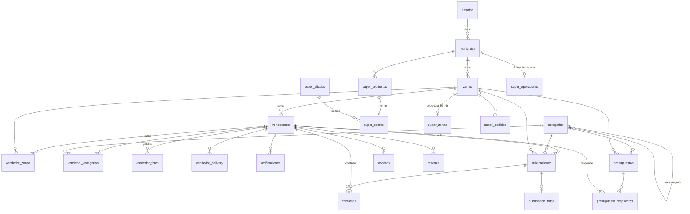

# Lokl — Propuesta de arquitectura (Fase 0 + Fase 1)

**Estado:** propuesta para aprobación · rama `rediseno-modular` · 8 de noviembre de 2026
**Base de datos:** borrador en `supabase/migrations/20261108000000_esquema_inicial.sql` (probado en PostgreSQL local, no aplicado en Supabase)

---

## 1. Qué es Lokl (la visión acordada)

Lokl **no reemplaza los grupos de WhatsApp: los ordena**. En los grupos todos envían y envían, y después es imposible encontrar lo que alguien publicó. Lokl es la memoria ordenada y buscable de lo que se vende y se ofrece en cada zona.

- **Gratis** para vendedores y clientes. Sin suscripciones.
- **Sin aprobaciones**: todo se publica al instante. El control es posterior (filtro de palabras, reportes, ocultar y suspender).
- **Por zonas**: estado → municipio → zona (sector, barrio, pueblo, caserío). Nace en Apure y crece a cualquier lugar de Venezuela agregando filas, no código.
- **Puerta al mundo** para productores de los pueblos (por ejemplo, el queso de La Macanilla o Cunaviche): precios reales de origen, visibles fuera de su comunidad.
- **Todo termina en WhatsApp**: el contacto y la negociación siguen siendo por WhatsApp o llamada.
- **Lokl Súper** es el único negocio propio y el único con margen: "supermercado cerca de ti, entrega en 30 minutos". Los aliados son internos.

### Las 6 secciones

| Sección | Qué es | Cómo se contacta |
|---|---|---|
| Tiendas | Productos de negocios locales | "Pedir por WhatsApp" |
| Comida | Restaurantes, cocinas, comida casera | "Pedir por WhatsApp" |
| Al mayor | Productores y precios de origen | WhatsApp |
| Servicios | Páginas amarillas: transporte, salud, hospedaje, oficios… | WhatsApp o llamada |
| Clasificados | Ventas de una vez (incluye el antiguo Mercadito) | WhatsApp |
| Lokl Súper | Supermercado de Lokl, entrega en 30 min | Carrito → pedido por WhatsApp |

---

## 2. Auditoría del código actual (Fase 0)

### Lo que hay
| Dato | Valor |
|---|---|
| Archivo principal | `app/page.js`: **630 KB**, 7.237 líneas, un solo componente `"use client"` |
| Peso comprimido de ese archivo | ~122 KB solo el código fuente, antes de sumar React, Next y Supabase |
| Variables de estado (`useState`) | 187 en un solo componente |
| Llamadas a Supabase | 149 (22 insert, 51 update, 18 delete) |
| `select("*")` | 36 veces (trae todas las columnas aunque no se usen) |
| Tablas usadas | 20 (proveedores, productos_proveedor, promociones_proveedor, pedidos, resenas, clasificados, servicios_turismo, productos_supermercado, habitaciones_hotel, servicios_comunidad, rutas_transporte, remates, suscriptores_promo, favoritos_cliente, zonas_delivery, combos, ventas, configuracion, clientes, zonas_operacion) |
| Otras rutas | `app/tienda/[id]/page.js` (vista previa para WhatsApp) |

### Los problemas más graves

**Seguridad (urgente, aunque todo sea de prueba)**
1. La clave del admin está escrita en el código (`ADMIN_USER = "admin"`, `ADMIN_PASS = "mimercado2024"`, línea 15). Cualquiera que abra la app puede verla en el navegador.
2. Las claves de los proveedores se guardan en texto plano (`password_plain`) y se comparan en el navegador. Para eso el navegador tiene que poder leerlas, así que **cualquiera puede leer las claves de todos los proveedores** desde la API pública.
3. Al registrarse, el proveedor queda `aprobado: true` (línea 1338): la aprobación "obligatoria" no existía en la práctica.

**Rendimiento y consumo de datos**
4. **Cada 15 segundos la app recarga todo** (`setInterval` en la línea 688: negocios, remates, servicios, clasificados y, si es proveedor o admin, también productos, pedidos y suscripciones). Con datos móviles caros esto es lo más dañino: **el teléfono gasta datos aunque la persona solo esté mirando la pantalla**.
5. Todo el código de todos los módulos (admin, panel del proveedor, súper, servicios…) se descarga en el primer render, aunque el cliente solo quiera buscar.
6. Nada se genera en el servidor: la vista previa de WhatsApp tuvo que resolverse con una ruta aparte y una redirección.

**Otros**
7. Los íconos `icon-192.png` e `icon-512.png` que pide `manifest.json` no existen (ya se generaron en `identidad/app/`).
8. Las credenciales de Supabase están repetidas en dos archivos en vez de variables de entorno.
9. La función `estaAbiertoAhora` actual permite que `forzar_abierto = true` abra un negocio **desactivado por el admin**. En el diseño nuevo, suspendido = siempre cerrado y oculto.

### Lógica de negocio que se conserva
- **Abierto/cerrado**: `forzar_abierto` (true / false / null) tiene máxima prioridad sobre el horario, en zona America/Caracas, incluido el horario que cruza la medianoche, y con el mismo ciclo del botón del vendedor. Queda en el front (`lib/horario.js`) y, por primera vez, también en la base de datos (`esta_abierto()`), para poder filtrar "Abierto ahora" en el buscador.
- **Cliente anónimo** con `lokl_cliente_id` (`crypto.randomUUID()` en localStorage), separado de Supabase Auth.
- **WhatsApp en iOS** con `window.location.href`, nunca `window.open`.
- **Markup solo en el Súper**; los precios de los vendedores se muestran exactos.
- **`comprimirImagen()`** con canvas: se conserva y mejora (ver sección 6).

### Lo que se elimina por decisión de producto
Suscripciones y período de prueba, aprobación de productos y proveedores, carrito multi-proveedor, formularios especiales de hoteles, turismo y rutas (pasan a ser fichas de servicio), y la separación entre Mercadito y Clasificados (se unen).

---

## 3. El dominio usalokl.com

**Recomendación: el dominio ES la app (opción a), con páginas informativas estáticas dentro.**

| | a) Dominio = app | b) Landing + app aparte |
|---|---|---|
| Enlaces que llegan de WhatsApp | Abren directo la tienda o el producto | Igual, pero la portada no ayuda a comprar |
| Velocidad | La portada es la búsqueda, generada en el servidor | Un paso extra antes de usar |
| Confianza | Se resuelve con `/conoce`, `/vende` y `/verificado` | Mejor primera impresión "corporativa" |
| Mantenimiento | Un solo proyecto | Dos sitios |

Como casi todo el tráfico llegará por enlaces compartidos en grupos, lo más rápido y útil es que la portada ya sirva: el buscador con las secciones. La confianza se gana con:
- `usalokl.com/conoce`: qué es Lokl, cómo funciona y quién está detrás.
- `usalokl.com/vende`: cómo publicar gratis.
- `usalokl.com/verificado`: qué significa el sello.

Las tres serían HTML puro, sin JavaScript.

---

## 4. Mapa de páginas (un módulo = una ruta)

**Público.** Todas se generan en el servidor como HTML puro (Astro, 0 KB de JavaScript), salen en buscadores y muestran la vista previa en WhatsApp.

| Ruta | Qué muestra |
|---|---|
| `/` | Buscador, secciones y "lo nuevo". Recuerda la zona del cliente |
| `/buscar?q=…` | Resultados agrupados por sección, filtros rápidos |
| `/apure/san-fernando` | Portada del municipio |
| `/apure/san-fernando/servicios/transporte/moto-taxi` | Listado por sección, categoría y subcategoría; filtro `?zona=el-recreo` |
| `/p/123-queso-llanero-duro` | Ficha de una publicación |
| `/queseria-la-macanilla` | **Tienda o ficha del vendedor**: un solo enlace con su logo en la vista previa |
| `/precios` | Precios de origen al mayor por zona |
| `/super` | Lokl Súper (solo si hay cobertura en tu zona) |
| `/conoce`, `/vende`, `/verificado` | Páginas informativas estáticas |

**Interactivas.** Son páginas Astro con una "isla" de Preact (~10 KB) solo donde hace falta, y se descargan solo al entrar.

| Ruta | Quién | Qué hace |
|---|---|---|
| `/super/carrito` | Cliente | Carrito del Súper → pedido por WhatsApp |
| `/favoritos`, `/mis-pedidos` | Cliente | Con `lokl_cliente_id` |
| `/presupuesto` | Cliente | "Pedir presupuesto a varios" |
| `/entrar` | Vendedor | Registro e inicio de sesión (Supabase Auth) |
| `/panel` | Vendedor | **Mi tienda**: logo, nombre, zona, horario, abierto/cerrado, "Copiar mi enlace", contador de contactos |
| `/panel/publicar` | Vendedor | Foto, nombre, precio y "¿al mayor?". Una sola pantalla |
| `/panel/publicaciones` | Vendedor | Cada una con *Renovar*, *Vendido* y *Borrar* |
| `/panel/presupuestos` | Vendedor | Solicitudes recibidas para responder con precio |
| `/panel/mas` | Vendedor | Galería, zonas de cobertura, delivery, formas de pago, variantes |
| `/admin/...` | Tú | Moderación, reportes, verificaciones, zonas, categorías, sinónimos, palabras prohibidas, Súper (catálogo, costos, aliados, pedidos), búsquedas sin resultado |

**Reglas de las direcciones**
- El enlace del vendedor va en la raíz (`/su-nombre`). Para eso hay una lista de nombres reservados (`super`, `panel`, `admin`, `buscar`, los slugs de los 24 estados…) que ningún vendedor puede usar.
- El estado va en la dirección (`/apure/...`) porque en Venezuela muchos municipios se llaman igual en distintos estados (Sucre, Bolívar, Miranda…).

### Estructura de carpetas

```
src/
  layouts/Base.astro         ← <head>, paleta, vista previa WhatsApp, barra inferior
  pages/
    index.astro              ← portada
    buscar.astro
    [estado]/[municipio]/[...ruta].astro
    [slug].astro             ← tienda del vendedor + vista previa WhatsApp
    p/[id].astro
    precios.astro · super/index.astro · super/carrito.astro
    presupuesto/ · favoritos.astro · mis-pedidos.astro
    conoce.astro · vende.astro · verificado.astro
    entrar.astro
    panel/   (requiere sesión) publicar · publicaciones · presupuestos · mas
    admin/   (solo admin) moderacion · verificaciones · zonas · categorias · super · metricas
  components/
    Icono.astro · Logo.astro · BarraInferior.astro   ← 0 KB de JavaScript
    islas/   ← componentes Preact (.jsx) solo para lo interactivo: carrito, publicar, botón abrir/cerrar
  lib/
    supabase/servidor.js · supabase/navegador.js   ← @supabase/ssr
    horario.js       ← estaAbiertoAhora + ciclo del botón (lógica actual intacta)
    whatsapp.js      ← enlaces wa.me, regla iOS, normalizar 58XXXXXXXXXX
    imagen.js        ← comprimirImagen mejorada (WebP + miniatura)
    cliente.js       ← lokl_cliente_id
  styles/globals.css
public/
  sw.js · manifest.webmanifest · iconos/
supabase/
  migrations/      ← el esquema como código
  seed.sql         ← Apure: municipios, zonas, categorías iniciales
legado/            ← la app vieja, solo como referencia
docs/
identidad/
```

---

## 5. Base de datos

### Recomendación: proyecto Supabase nuevo
Como todo es de prueba, propongo **crear un proyecto Supabase nuevo** (el plan gratis permite dos). El esquema se aplica desde el repositorio con la CLI de Supabase (`supabase db push`), y la app actual sigue funcionando con su base vieja hasta el día del cambio. Así nunca hay nada roto en el medio.

### Diagrama entidad-relación



### Tablas (33): de 20 tablas con datos duplicados a un modelo normalizado

| Grupo | Tablas | Para qué |
|---|---|---|
| Ubicación | `estados`, `municipios`, `zonas` | Jerarquía. `zonas.tipo` = sector, urbanización, barrio, pueblo, caserío. Los vendedores pueden proponer zonas (`activa = false` hasta que las revises) |
| Categorías | `categorias`, `sinonimos`, `categorias_sugeridas` | Sección fija (enum) → categoría → subcategoría (`padre_id`). Cada una con ícono Lokl, orden y `palabras_clave` para el buscador |
| Vendedores | `vendedores`, `vendedor_zonas`, `vendedor_categorias` (máx. 3), `vendedor_fotos` (máx. 6), `vendedor_delivery`, `verificaciones` | Tienda o ficha. `estado` = activo o suspendido (reemplaza `activo` + `aprobado`). `verificado_en` = sello Lokl |
| Publicaciones | `publicaciones`, `publicacion_fotos` | Una sola tabla para productos, comida, al mayor y clasificados. Reemplaza productos_proveedor, promociones, combos, remates y clasificados |
| Cliente anónimo | `favoritos`, `resenas` | Por `cliente_id` (uuid de localStorage) |
| Moderación | `palabras_prohibidas`, `reportes`, `moderacion_log` | Control posterior, sin aprobaciones |
| Métricas | `contactos`, `busquedas` | Contador para el vendedor; búsquedas sin resultado para ti |
| Presupuestos | `presupuestos`, `presupuesto_respuestas`, `push_suscripciones` | "Pedir presupuesto a varios" |
| Súper | `super_zonas`, `super_productos`, `super_pedidos`, `super_lista_espera` (públicas o del cliente) · `super_aliados`, `super_costos` (**solo admin**) · `super_operadores` (futuro) | El cliente nunca ve costos ni aliados |
| Sistema | `configuracion`, `admins` | Ajustes (súper abierto, límites) y quién es admin |

El detalle de cada columna está comentado en el archivo SQL. Cuando apruebes la propuesta preparo `docs/base-de-datos.md` con el diccionario de datos completo y las políticas RLS tabla por tabla.

### Reglas que viven en la base de datos (no se pueden saltar desde el navegador)

| Regla | Cómo |
|---|---|
| Filtro de palabras prohibidas | Trigger: si el título o la descripción contienen una palabra de la lista, la publicación queda `en_revision` y no sale. Se compara sin acentos y por palabra completa |
| 3 reportes → se oculta sola | Trigger en `reportes` (el número se ajusta en `configuracion`). Un cliente solo puede reportar una vez cada cosa. Los vendedores reportados no se suspenden solos: eso lo decides tú |
| Límite anti-spam | Máximo 30 publicaciones por día por vendedor (ajustable) |
| Caducidad a 30 días | Tarea nocturna con `pg_cron` → `vencida`. El vendedor la renueva con un toque |
| Precio del Súper | Al guardar costo + margen, el precio público se recalcula solo. El costo vive en una tabla que solo ve el admin |
| Máximo 3 categorías por vendedor | Trigger |
| Abierto/cerrado | Función `esta_abierto()`, idéntica a la del front |
| Suspensión | Vendedor suspendido = desaparece de todo (RLS + buscador) |

### Seguridad (RLS)
- RLS activado en **todas** las tablas, con las políticas versionadas en el repositorio.
- Lectura pública solo de lo visible (`estado = 'publicada'`, vendedor activo).
- El vendedor solo edita lo suyo (`usuario_id = auth.uid()`) y no puede cambiarse a sí mismo el estado ni el sello de verificado.
- El admin se identifica con la tabla `admins` y la función `es_admin()`. Nunca más una clave en el código.
- El cliente anónimo puede crear favoritos, reseñas, reportes y presupuestos. Lo suyo lo lee a través de funciones que reciben su `cliente_id`, sin exponer los datos de los demás.

### Índices pensados para el teléfono
- **Índices parciales** solo sobre lo visible (`where estado = 'publicada'`): son más pequeños y rápidos.
- GIN sobre `tsvector` para búsqueda de texto y trigramas para tolerar errores de tipeo.
- Índices compuestos (zona, sección, fecha) para los listados.

### Probado
El SQL se aplicó en un PostgreSQL 18 local con datos de ejemplo y se verificó:
- Buscar "queso duro" desde El Recreo encuentra el *Queso llanero duro* de La Macanilla (por sinónimo, aunque es de otro municipio).
- Buscar "kezo llanero" lo encuentra igual (error de tipeo).
- "Vendo arma…" queda en revisión por el filtro; si el admin la republica, no se vuelve a frenar.
- 3 reportes ocultan la publicación.
- Costo $2,00 con 15 % de margen da un precio público de $2,30.
- Abierto/cerrado: forzado gana al horario y a la pausa; suspendido nunca abre.
- El cuarto intento de categoría se rechaza.

Las políticas RLS todavía no se probaron con usuarios reales; eso se hará en el proyecto de Supabase.

---

## 6. El buscador

Una sola función en la base de datos, `buscar()`, para todo Lokl. Así cada búsqueda es **una sola llamada** desde el teléfono.

1. **Busca en publicaciones y en vendedores** (las fichas de servicio se encuentran por nombre, categoría, descripción y precios de referencia).
2. **Ignora acentos y mayúsculas**, y entiende singular y plural (raíces en español).
3. **Tolera errores de tipeo** ("kezo", "mototasi") con similitud por trigramas.
4. **Sinónimos que tú controlas** (tabla `sinonimos`), más las `palabras_clave` de cada categoría.
5. **La zona ordena, no esconde**: primero tu zona, después tu municipio, después todo lo demás. Así el queso de Cunaviche aparece aunque busques desde San Fernando. Ese es el sentido de "puerta al mundo".
6. **Los verificados suben un poco** en el orden.
7. **Filtros rápidos**: sección, "Abierto ahora", municipio.
8. **Registra cada búsqueda** con su número de resultados. En el admin verás, por ejemplo, "plomero Biruaca: 12 búsquedas sin resultado esta semana".

**Próximo paso del buscador**: autocompletado mientras se escribe (categorías + búsquedas populares en tu zona), con un retraso de 250 ms para no gastar datos con cada letra.

---

## 7. Funciones nuevas acordadas

**Verificado por Lokl**
Es la certificación de Lokl de que el negocio existe. **No es un requisito para publicar.** Tú la otorgas desde el admin indicando el método (visita, documentos, videollamada o referencia), y queda el historial en `verificaciones`. Se puede revocar. El sello verde aparece en la ficha y en los resultados, y los verificados suben un poco en el buscador. La página `/verificado` explica qué significa.

**Contador para el vendedor**
Cada toque en WhatsApp, llamada, visita a la ficha o "compartir" se registra en `contactos`. En su panel el vendedor ve, por ejemplo: "Esta semana **34 personas** te contactaron desde Lokl". Esto reemplaza la "inteligencia de negocio" actual con algo que todos entienden.

**Pedir presupuesto a varios** (por ejemplo, un repuesto)
1. El cliente describe lo que busca (y puede poner una foto), elige categoría y zona, y deja su nombre y WhatsApp.
2. Lokl se lo envía a los vendedores de esa categoría en su zona y municipio (hasta 8, verificados primero).
3. Cada vendedor lo ve en `/panel/presupuestos` y recibe una **notificación push** gratis en su teléfono (funciona en Android y en iPhone con la app instalada). Responde con precio y una nota.
4. El cliente ve las respuestas ordenadas por precio en `/presupuesto/[id]` y escribe por WhatsApp al que le convenga.
5. La solicitud vence a los 3 días.

Es un solo clic para el cliente y ninguna vuelta por la ciudad. Más adelante, si algún día hay presupuesto para la API oficial de WhatsApp Business, se puede avisar por WhatsApp en vez de push.

**Al mayor / precios de origen**
Una publicación marcada "al mayor" tiene precio por unidad (kg, pieza, bulto…), cantidad mínima y disponibilidad. `/precios` muestra la tabla pública "producto · zona · precio · fecha". El formulario de publicar funciona con mala señal: guarda en el teléfono y envía cuando hay conexión.

**Lokl Súper: la fuente de ingresos, siempre a la vista** *(aprobado 8/11/2026)*
- **Pestaña fija en la barra inferior**: Inicio · **Súper** · Buscar · Publicar · Mi cuenta.
- **Portada**: franja destacada "Lokl Súper · en 30 min a tu puerta" con las ofertas del día, arriba de todo, cuando la zona tiene cobertura.
- **En el buscador**: si alguien busca "harina", "aceite" o "pañales", el primer bloque es "En Lokl Súper · llega en 30 min", antes que los demás resultados.
- **Repetir mi último pedido** con un toque, y **listas armadas** ("Desayuno", "Parrilla del domingo", "Lo básico de la semana").
- **Envío gratis desde $X** y aviso de horario ("pide antes de las 8 pm").
- **Zona sin cobertura**: en vez de esconder el Súper, se muestra "Avísame cuando llegue a mi zona". Esa lista de espera por zona te dice dónde expandirte (tabla nueva `super_lista_espera`).
- Catálogo por municipio, carrito, pedido guardado en `super_pedidos` y confirmación por WhatsApp.
- El admin ve los pedidos por estado (nuevo → confirmado → comprando → en camino → entregado), con el aliado de cada producto para armar la ruta de compra.
- Futuro: un operador exclusivo por municipio (`super_operadores`).

**Comida = Feria de comida** *(aprobado 8/11/2026)*
- Se siente como una feria: cada vendedor es un **puesto** con su logo, sus platos y si está "Abierto ahora". Los abiertos y los cercanos van primero.
- Caben todos: restaurantes, food trucks, puestos de calle, **cocinas desde casa** (postres, tortas, comida casera) y **cocinas ocultas** (solo delivery).
- Campo nuevo `vendedores.modalidad_cocina`: restaurante · puesto/food truck · desde casa · cocina oculta. Los que cocinan desde casa muestran **solo su zona, nunca su dirección**.
- **Botones por antojo** con íconos Lokl: Pizza, Hamburguesas, Perros, Arepas, Empanadas, Parrilla, Pollo, Comida casera, Postres y tortas, Saludable, Bebidas… (son subcategorías de Comida que tú manejas).
- **Buscar "pizza"** da "Pizza: 8 puestos", y cada puesto se muestra con sus pizzas y su rango de precios ("desde $6"). Funciona por la subcategoría del vendedor y por los títulos de sus platos.
- **Por encargo**: postres y tortas con "pide con 24 h de anticipación"; **menú del día** que se renueva solo cada día.

**Clasificados abiertos a cualquier persona** *(aprobado 8/11/2026)*: con una cuenta sencilla tipo "persona" (ver creación de cuenta).

---

## 8. Presupuesto de rendimiento

| Regla | Meta |
|---|---|
| JavaScript en páginas públicas | **0 KB** (HTML puro con Astro; solo ~200 bytes en línea para el service worker) |
| JavaScript en panel y admin | Preact ~10 KB + el código de la pantalla, < 50 KB por ruta |
| Fuentes | **0 KB** (fuentes del sistema) |
| Íconos | SVG propios en línea (~300 bytes cada uno) |
| Imagen en listas | Miniatura WebP de ~400 px, **~25 KB** |
| Imagen en ficha | WebP de 1200 px, ~120 KB, con carga diferida |
| Recarga automática cada 15 s | **Eliminada**. Los datos se refrescan al volver a la pantalla o al deslizar hacia abajo |
| Librerías externas | Solo `astro`, `preact`, `@supabase/supabase-js` y `@supabase/ssr`. Nada de librerías de gráficos (el contador es texto y barras en CSS) ni de mapas (un botón abre Google Maps) |

**Imágenes**
`comprimirImagen()` mejorada: en el teléfono, antes de subir, genera **dos versiones en WebP**, una grande y una miniatura. No se usa la optimización de imágenes del alojamiento ni las transformaciones de Supabase (ambas tienen límites o costo); las imágenes se sirven directo desde Storage con caché larga.

**PWA y service worker** (hecho a mano, sin librerías)
- Guarda la "cáscara" de la app, los íconos y el CSS: en la segunda visita casi no se descarga nada.
- Las fotos ya vistas quedan guardadas en el teléfono.
- Las páginas públicas usan "muestra lo guardado y actualiza por detrás".
- Si no hay señal, se muestra lo último visto.

**Caché en el servidor**
Las páginas públicas se guardan 60 segundos en la red de Cloudflare (y se siguen sirviendo mientras se regeneran), así que miles de visitas no golpean la base de datos.

---

## 9. Plan de migración, módulo por módulo

Cada paso termina con algo que funciona, una medición del peso y tu visto bueno antes del siguiente.

| # | Módulo | Qué incluye |
|---|---|---|
| 1 | **Cimientos** | Proyecto Supabase nuevo, migraciones con CLI, variables de entorno, layout, paleta e íconos, `lib/` (horario, whatsapp, imagen, cliente), service worker básico |
| 2 | **Zonas y categorías** | Datos iniciales de Apure (te preparo la lista para que la corrijas) y admin mínimo para editarlos |
| 3 | **Vendedor: cuenta y tienda** | Registro e inicio de sesión seguro, `/panel` (Mi tienda), página pública `/[slug]` con logo en la vista previa |
| 4 | **Publicar** | `/panel/publicar`, `/panel/publicaciones`, ficha `/p/[id]`, fotos comprimidas, caducidad y renovar |
| 5 | **Buscador y listados** | Portada, `/buscar`, listados por municipio, sección y categoría |
| 6 | **Moderación** | Palabras prohibidas, reportes, ocultar y suspender, bitácora, verificaciones |
| 7 | **Servicios (páginas amarillas)** | Galería de 6 fotos, zonas de cobertura, 24 h, a domicilio, formas de pago, disponible ahora |
| 8 | **Cliente** | Favoritos, reseñas, "lo nuevo de tus favoritos", contador de contactos |
| 9 | **Al mayor** | Campos al mayor, `/precios`, publicar sin señal |
| 10 | **Lokl Súper** | Catálogo, cobertura por zona, carrito, pedidos, aliados y costos internos |
| 11 | **Pedir presupuesto** | Flujo completo y notificaciones push |
| 12 | **Lanzamiento** | `/conoce`, `/vende`, `/verificado`, PWA completa, medición final y cambio de `main` a la versión nueva |

Durante todo el proceso, `main` y `usalokl.com` siguen con la versión actual. Cloudflare genera una vista previa de la rama `rediseno-modular` para que pruebes cada módulo en tu teléfono antes de aprobarlo.

---

## 10. Creación de cuenta del vendedor (propuesta)

Meta: **tienda lista en menos de 2 minutos**, desde el teléfono.

| Paso | Pantalla | Detalle |
|---|---|---|
| 0 | `/vende` | "Crea tu tienda gratis" + 3 beneficios + botón |
| 1 | **Entrar** | **"Continuar con Google"** (un toque: casi todo Android ya tiene cuenta Google) o **correo + contraseña**. Ambos gratis en Supabase |
| 2 | **¿Qué haces?** | 5 botones grandes con ícono: Vendo productos · Vendo comida · Ofrezco un servicio · Produzco al mayor · Solo quiero vender algo (clasificados) |
| 3 | **Tu tienda** | Nombre · WhatsApp (con botón "Probar" que abre su propio chat) · Zona (buscador estado → municipio → zona, o "No está mi zona" para proponerla) · Logo (opcional, se puede saltar) |
| 4 | **¡Lista!** | Muestra `usalokl.com/su-nombre` (se genera del nombre y se puede editar) · "Compartir mi tienda en WhatsApp" · "Publicar mi primer producto" |

- La categoría, el horario, la galería y lo demás se completan después, desde el panel, sin obligar.
- "Olvidé mi contraseña" por correo, automático. Se acaba el "escríbele a Lokl por WhatsApp".
- **Cuenta "persona"** (clasificados): mismos pasos 1 a 3, sin logo. Tiene su página, pero no aparece como tienda en la feria ni en los servicios.
- **Cuenta asistida** (futuro): tú o un promotor de zona crean la tienda de un productor que no maneja el teléfono, con su WhatsApp. Cuando quiera, el productor la reclama y queda como dueño.

## 11. Decisiones

| # | Decisión | Estado |
|---|---|---|
| 1 | Propuesta general | **Aprobada** (8/11/2026) |
| 2 | Proyecto Supabase nuevo en la misma cuenta de Lokl, región East US | **Aprobado** |
| 3 | Enlace del vendedor en la raíz (`usalokl.com/su-nombre`) | **Aprobado** |
| 4 | Inicio de sesión: Google + correo y contraseña con confirmación de correo (SMTP propio) | **Aprobado** |
| 5 | Clasificados abiertos a cualquier persona | **Aprobado** |
| 6 | Súper con máxima visibilidad (pestaña fija, portada, buscador) | **Aprobado** |
| 7 | Comida como Feria de comida (incluye "desde casa" y cocinas ocultas) | **Aprobado** |
| 8 | Astro + islas de Preact en vez de Next.js (Next pesaba ~133 KB de JavaScript base, la meta era 70 KB) | **Aprobado** (8/11/2026) |
| 9 | Alojamiento en Cloudflare Workers en vez de Vercel (el plan gratis de Vercel no permite uso comercial) | **Aprobado** (8/11/2026) |
